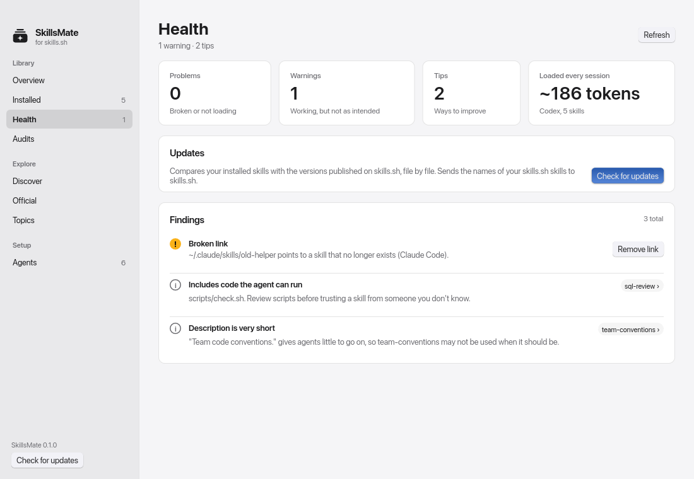
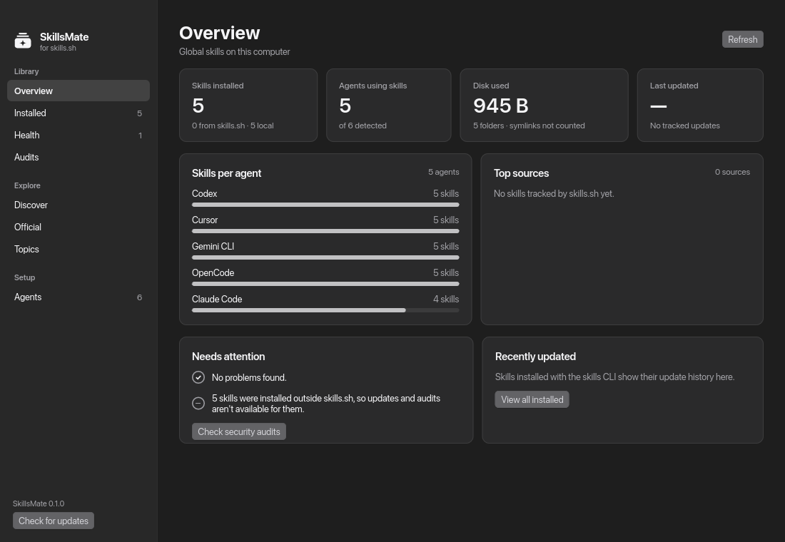
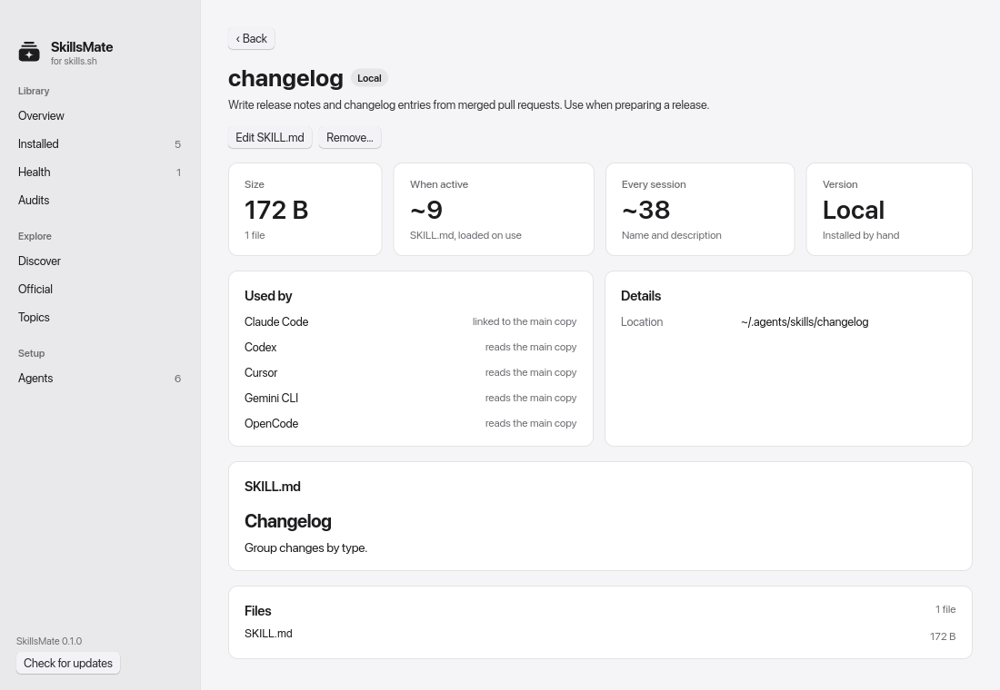
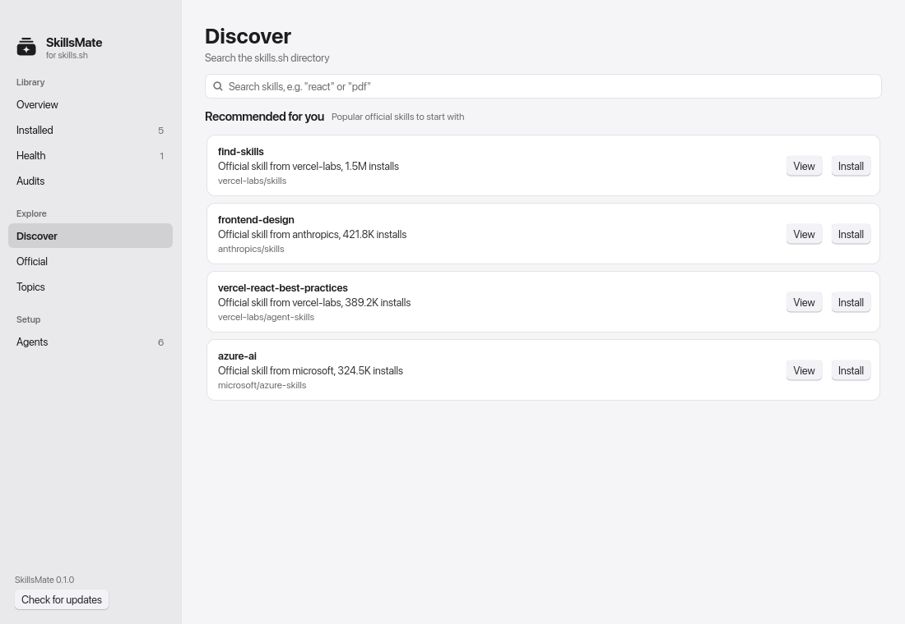

# SkillsMate

A fast, safe desktop app for managing the [skills.sh](https://www.skills.sh/) skills your coding agents use: Claude Code, Codex, Cursor, Gemini CLI and 70+ more. Built in Rust with [Slint](https://slint.dev).

[](https://github.com/homielab/skillsmate/actions/workflows/ci.yml)
[](LICENSE)

> Status: early but useful. Releases ship for macOS and Linux. Windows builds and passes tests, but there is no installer yet.



## Features

- **Overview:** skills installed, agents using them, disk used, last update, skills per agent, top sources, recent updates, and a "needs attention" list.
- **Health:** checks every skill against the [Agent Skills spec](https://agentskills.io/specification) and how agents actually load skills: broken links, out-of-sync copies, skills no agent can see, invalid SKILL.md files, names and descriptions agents can't use well, oversized SKILL.md files, overlapping skills, bundled scripts, and how many tokens your skills add to every session. Broken links and drifted copies have one-click fixes, and all broken links can be removed at once.
- **Updates:** compares installed skills with the versions published on skills.sh, file by file, shows exactly what changed, and tells your local edits apart from upstream updates for skills SkillsMate installed.
- **Install, update, remove, edit:** from Discover, Topics and recommendations. Installs land in `~/.agents/skills` and are linked into each agent exactly like `npx skills add -g`. Edit any SKILL.md in place; edits are validated before saving.
- **Nothing is lost:** every change moves the old version into a backup first (`<data dir>/SkillsMate/backups`), and Undo restores it.
- **Skill details:** rendered SKILL.md, files, token cost, which agents use it and how, health findings, version, and what changed upstream.
- **Recommendations:** suggestions from topics and repos you already use, and popular official skills, each with the reason it was picked.
- **Audits:** checks installed skills against skills.sh's security partners (Gen Agent Trust Hub, Socket, Snyk, Runlayer, ZeroLeaks).
- **Discover, Official, Topics, Agents:** search skills.sh, browse first-party skills from 100+ companies and curated topics, and see all 78 supported agents.
- **App updates:** shows the version and checks GitHub releases for a newer SkillsMate.
- Light and dark mode follow the system; set `SKILLSMATE_THEME=dark` or `light` to override.

| Overview (dark) | Skill details | Discover |
| --- | --- | --- |
|  |  |  |

Online checks (updates, audits) run only when you ask, since they send the names of your skills to skills.sh. SkillsMate sends no telemetry.

## Install

### macOS

Download `SkillsMate-<version>-macos-universal.zip` from the [Releases](https://github.com/homielab/skillsmate/releases) page, unzip it, and move SkillsMate to Applications. It runs on Apple silicon and Intel Macs with macOS 11 or newer.

The app isn't notarized yet, so the first time, right-click SkillsMate and choose Open, then confirm.

### Ubuntu / Debian (.deb)

Download `skillsmate_<version>-1_amd64.deb` from the [Releases](https://github.com/homielab/skillsmate/releases) page, then:

```sh
sudo apt install ./skillsmate_*_amd64.deb
```

SkillsMate appears in your app launcher. Remove it with `sudo apt remove skillsmate`. Works on Ubuntu 22.04 and newer.

### Any Linux distribution (AppImage)

Download `SkillsMate-<version>-x86_64.AppImage` from Releases, then:

```sh
chmod +x SkillsMate-*-x86_64.AppImage
./SkillsMate-*-x86_64.AppImage
```

On Ubuntu 22.04+, AppImages need FUSE 2: `sudo apt install libfuse2t64` (24.04) or `sudo apt install libfuse2` (22.04).

Each release includes a `SHA256SUMS` file to verify downloads: `sha256sum -c SHA256SUMS --ignore-missing`.

## Layout

```
crates/
  skills-core/   UI-free core: agent registry, lockfiles, SKILL.md parsing, scanning, skills.sh search
  skills-app/    Slint desktop app (binary: `skillsmate`)
packaging/
  icons/         App icon (SVG source + rendered PNGs)
  linux/         Desktop entry and AppImage build script
  macos/         .app bundle build script
tools/
  gen_agents.py  Regenerates the agent registry from the upstream CLI source
```

## Build from source

You need Rust 1.92 or newer. On Linux, also install the windowing libraries (`libfontconfig1-dev` and `libxkbcommon-dev` on Debian/Ubuntu).

```sh
cargo run -p skills-app          # debug
cargo build --release            # optimized binary in target/release/skillsmate
cargo test --workspace
# Live checks against skills.sh (network; run when the site changes):
cargo test -p skills-core --test directory_live -- --ignored
```

Packages:

```sh
cargo install cargo-deb && cargo deb -p skills-app   # target/debian/*.deb
packaging/linux/build-appimage.sh                    # dist/*.AppImage, after a release build
packaging/macos/build-app.sh                         # dist/SkillsMate.app (unsigned), after a release build on macOS
```

`SKILLSMATE_SNAPSHOT=<dir>` opens every page in turn, saves each as `<dir>/<page>.bmp` and quits. Use it to check the UI where screen capture isn't available.

## Compatibility with the `skills` CLI

SkillsMate reads and writes the same files as the official CLI ([vercel-labs/skills](https://github.com/vercel-labs/skills)), so you can mix both freely:

- Skills are stored in `<base>/.agents/skills/<name>`; other agents get symlinks (junctions on Windows) or copies in their own skills folders.
- Global installs are tracked in `~/.agents/.skill-lock.json` (or `$XDG_STATE_HOME/skills/.skill-lock.json`), project installs in `skills-lock.json`.
- The agent registry is generated from the upstream CLI's source (see [CONTRIBUTING.md](CONTRIBUTING.md#updating-the-agent-list)).

Unlike the CLI, SkillsMate never silently discards a lockfile it can't read, and it sends no telemetry.

## Contributing

Issues and pull requests are welcome. See [CONTRIBUTING.md](CONTRIBUTING.md), and report security issues privately as described in [SECURITY.md](SECURITY.md).

## License

SkillsMate is released under the [MIT License](LICENSE). Copyright © 2026 HomieLab.com.

Its UI uses [Slint](https://slint.dev) under the Slint Royalty-free Desktop License.

[](https://slint.dev)

SkillsMate is an independent project. It is not affiliated with or endorsed by skills.sh or Vercel.
